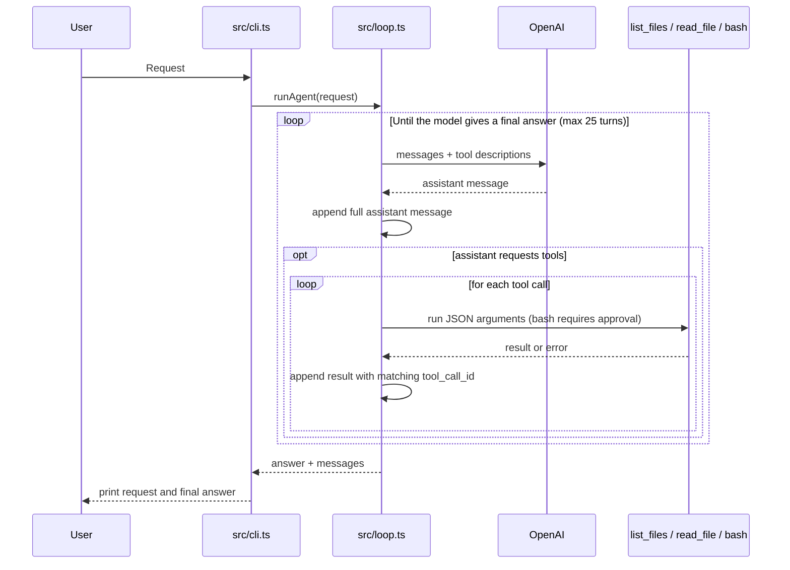

# mini-agent

I built this to see the coding-agent loop for myself. It uses Bun, TypeScript, and OpenAI Chat Completions. It can list files, read them, and run user-approved shell commands.

## Run

Install dependencies, set `OPENAI_API_KEY` in your shell, and ask a question:

```sh
bun install
bun run start "Find the code that limits directory listings. How many paths can it return?"
```

The default model is `gpt-4o-mini`. Set `AGENT_MODEL` to use another OpenAI model. You can also pipe a request: `echo "Read README.md" | bun run start`.

Run it in a directory without secrets. `read_file` sends requested file contents to OpenAI. The CLI prints only your request and the final answer, apart from approval prompts. File paths are checked against the working directory, but approved shell commands can leave it and inherit environment variables, including `OPENAI_API_KEY`. Neither confirmation nor the working directory is a sandbox.

Before each `bash` command, the CLI shows the command and working directory and asks for `y` or `Y`. Piped input cannot approve a command. `bash` uses blocking `Bun.spawnSync`, so it blocks the JavaScript event loop until the command exits or its 30-second timeout. The timeout sends `SIGKILL` to the shell process; child processes may survive. The tool truncates the returned text to 8,000 characters, but `spawnSync` captures full stdout and stderr first, so this is not a memory limit.

## How it works



`src/loop.ts` keeps the full assistant tool call in the conversation. Each result goes back with the same `tool_call_id`, so OpenAI knows which call it answers.

- `list_files` returns up to 200 paths. It skips `.git`, `node_modules`, and symlinks, and stops walking when it finds a 201st file.
- `read_file` returns raw text. Both tools stay inside the working directory and limit results to 8,000 characters.
- `bash` runs `/bin/bash -c` after approval. It returns the exit code and separate stdout and stderr, or a denial, signal, or timeout message. Its returned text is capped at 8,000 characters after capture.

If there is an `AGENT.md` in the working directory, the loop adds it to the system prompt. The CLI handles one request at a time. There is no REPL, line-range reader, or dedicated file-editing tool yet. Approved shell commands can still change files.

## Check it

Run `bun test` and `bunx tsc --noEmit`. See [BACKLOG.md](BACKLOG.md) for deferred improvements.
