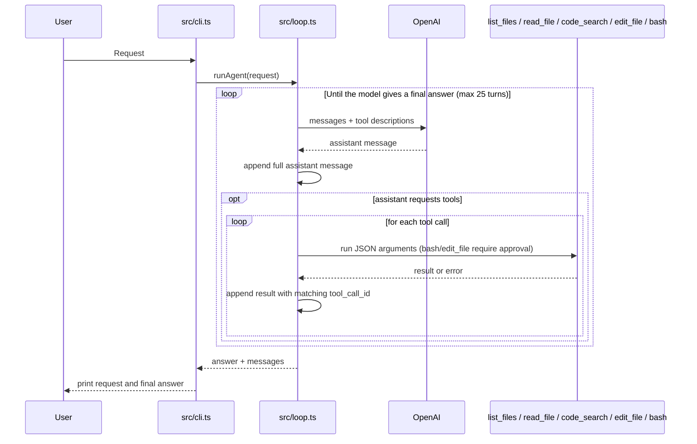

# mini-agent

I built this to see the coding-agent loop for myself. It uses Bun, TypeScript, and OpenAI Chat Completions. It can list files, search code, read files, make user-approved text edits, and run user-approved shell commands.

## Run

Install ripgrep first (`brew install ripgrep` on macOS; `sudo apt install ripgrep` on Debian/Ubuntu). Then install dependencies, set `OPENAI_API_KEY` in your shell, and ask a question:

```sh
bun install
rg --version
bun run start "Find the code that limits directory listings. How many paths can it return?"
```

`bun install` does not install `rg`; `code_search` requires the ripgrep executable on `PATH`.

The default model is `gpt-4o-mini`. Set `AGENT_MODEL` to use another OpenAI model. You can also pipe a request: `echo "Read README.md" | bun run start`.

Run it in a directory without secrets. `read_file` sends requested file contents to OpenAI, and `code_search` sends matching lines. The CLI prints only your request and the final answer, apart from approval prompts. File paths are checked against the working directory, but approved shell commands can leave it and inherit environment variables, including `OPENAI_API_KEY`. Neither confirmation nor the working directory is a sandbox.

Before each `bash` command or `edit_file` change, the CLI shows what will run or change and asks for `y` or `Y`. Piped input cannot approve an action. `bash` uses blocking `Bun.spawnSync`, so it blocks the JavaScript event loop until the command exits or its 30-second timeout. The timeout sends `SIGKILL` to the shell process; child processes may survive. The tool truncates the returned text to 8,000 characters, but `spawnSync` captures full stdout and stderr first, so this is not a memory limit.

## How it works



`src/loop.ts` keeps the full assistant tool call in the conversation. Each result goes back with the same `tool_call_id`, so OpenAI knows which call it answers.

- `list_files` returns up to 200 paths. It skips `.git`, `node_modules`, and symlinks, and stops walking when it finds a 201st file.
- `read_file` returns raw text and stays inside the working directory, limiting results to 8,000 characters.
- `code_search` uses ripgrep regexes in a file or directory (the project root by default), with an optional glob. Paths resolve inside the working directory; results include file and line numbers, capped at 100 lines and 8,000 characters.
- `edit_file` replaces one unique, exact text occurrence in an existing UTF-8 file after showing the target and full old/new strings for approval. The target must resolve inside the working directory and be a regular file. File creation is not supported.
- `bash` runs `/bin/bash -c` after approval. It returns the exit code and separate stdout and stderr, or a denial, signal, or timeout message. Its returned text is capped at 8,000 characters after capture.

For example, ask the agent: `Search src for TODO comments in TypeScript files` to have it call `code_search` with a pattern, path, and glob.

If there is an `AGENT.md` in the working directory, the loop adds it to the system prompt. The CLI handles one request at a time. There is no REPL or line-range reader. Approved shell commands can still change files; see [BACKLOG.md](BACKLOG.md) for edit race and write-failure limitations.

## Check it

Run `bun test` and `bunx tsc --noEmit`. See [BACKLOG.md](BACKLOG.md) for deferred improvements.
