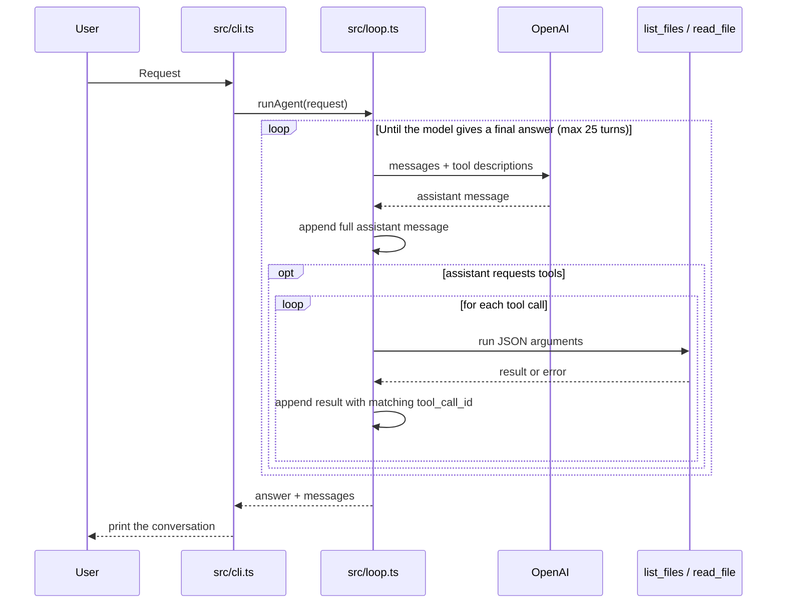

# mini-agent

I built this to see the coding-agent loop for myself. It uses Bun, TypeScript, and OpenAI Chat Completions. So far it can list files and read them. It cannot run commands or edit files yet.

## Run

Install dependencies, set `OPENAI_API_KEY` in your shell, and ask a question:

```sh
bun install
bun run start "Find the code that limits directory listings. How many paths can it return?"
```

The default model is `gpt-4o-mini`. Set `AGENT_MODEL` to use another OpenAI model. You can also pipe a request: `echo "Read README.md" | bun run start`.

Run it in a directory without secrets. `read_file` sends requested file contents to OpenAI and prints them in your terminal. The path check blocks files outside the working directory, not secrets inside it. Keep your API key out of the repo.

## How it works



`src/loop.ts` keeps the full assistant tool call in the conversation. Each result goes back with the same `tool_call_id`, so OpenAI knows which call it answers.

- `list_files` returns up to 200 paths. It skips `.git`, `node_modules`, and symlinks, and stops walking when it finds a 201st file.
- `read_file` returns raw text. Both tools stay inside the working directory and limit results to 8,000 characters.

If there is an `AGENT.md` in the working directory, the loop adds it to the system prompt. The CLI handles one request at a time. No REPL, line ranges, or file edits yet.

## Check it

Run `bun test` and `bunx tsc --noEmit`.
